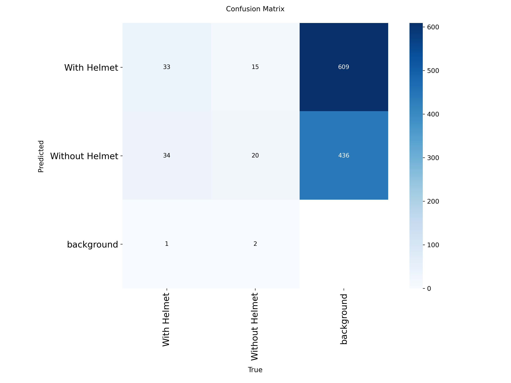
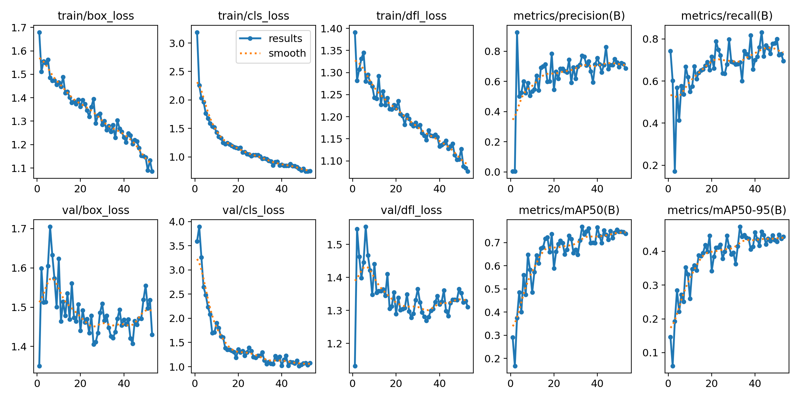

# Helmet Detection System

Real-time helmet detection built with YOLOv8 and Streamlit. The model detects whether a rider is wearing a helmet in images, videos, and a live camera feed.

<!-- Add your demo GIF here, for example:  -->

## Features

- **Image and video upload:** input and detection output shown side by side
- **Live camera mode:** real-time detection from your webcam
- **Adjustable confidence threshold** from the sidebar
- **Per-class detection counts** (With Helmet / Without Helmet)
- **Downloadable annotated video** after processing

## Results

Evaluated on a held-out test split that was not used during training or tuning.

| Metric | Score |
|---|---|
| mAP@50 | 0.73 |
| mAP@50-95 | 0.44 |
| Precision | 0.67 |
| Recall | 0.75 |

Training curves and the confusion matrix are in the `assets/` folder.




## Model and training

- **Model:** YOLOv8n (pretrained on COCO, fine-tuned on this dataset)
- **Hardware:** Google Colab, T4 GPU
- **Settings:** image size 640, batch size 16, up to 100 epochs, early stopping with patience 20 (training stopped at epoch 75)
- **Classes:** `With Helmet`, `Without Helmet`
- **Training notebook:** [`notebooks/train.ipynb`](notebooks/train.ipynb)

## Dataset

Downloaded from Kaggle. The dataset's metadata lists the original source as the **helmet-detect** project on Roboflow Universe by moeezs-workspace, licensed under **CC BY 4.0**.

- Training set: 432 images
- Separate validation and test splits

The dataset is not included in this repository. Please download it from the original source to retrain.

## Project structure

```
helmet-detection/
  app/
    ui.py              # Streamlit application
  src/
    predict.py         # run the model on an image, video, or folder
    webcam.py          # live webcam detection (OpenCV window)
  models/
    best.pt            # trained weights
  notebooks/
    train.ipynb        # Colab training notebook
  assets/              # result plots and demo media
  requirements.txt
  README.md
```

## Setup

```bash
git clone <your-repo-url>
cd helmet-detection

python -m venv venv
# Windows: venv\Scripts\activate
source venv/bin/activate

pip install -r requirements.txt
```

## Usage

**Streamlit app**
```bash
streamlit run app/ui.py
```
Choose **Upload** to process an image or video, or **Live camera** for real-time detection.

**Predict on a file**
```bash
python src/predict.py path/to/image_or_video
```
Results are saved to `outputs/pred/`.

**Live webcam (OpenCV window)**
```bash
python src/webcam.py
```
Press `q` to quit.

## Limitations

<!-- Replace with the failure cases you actually saw in your test outputs -->
- The training set is small (432 images), so the model may not generalize well to new scenes.
- Small or distant riders may be missed.
- Low light or blur can reduce accuracy.
- Other headwear (caps, hoods) may be confused with helmets.

## Future work

- Train on a larger and more varied dataset
- Compare larger models (YOLOv8s/m) and larger image sizes
- Add more augmentation
- Deploy the app online

## Tech stack

Python, Ultralytics YOLOv8, OpenCV, Streamlit, streamlit-webrtc, Google Colab

## Acknowledgements

- Dataset: helmet-detect by moeezs-workspace (Roboflow Universe), CC BY 4.0, accessed through Kaggle
- [Ultralytics YOLOv8](https://github.com/ultralytics/ultralytics)
